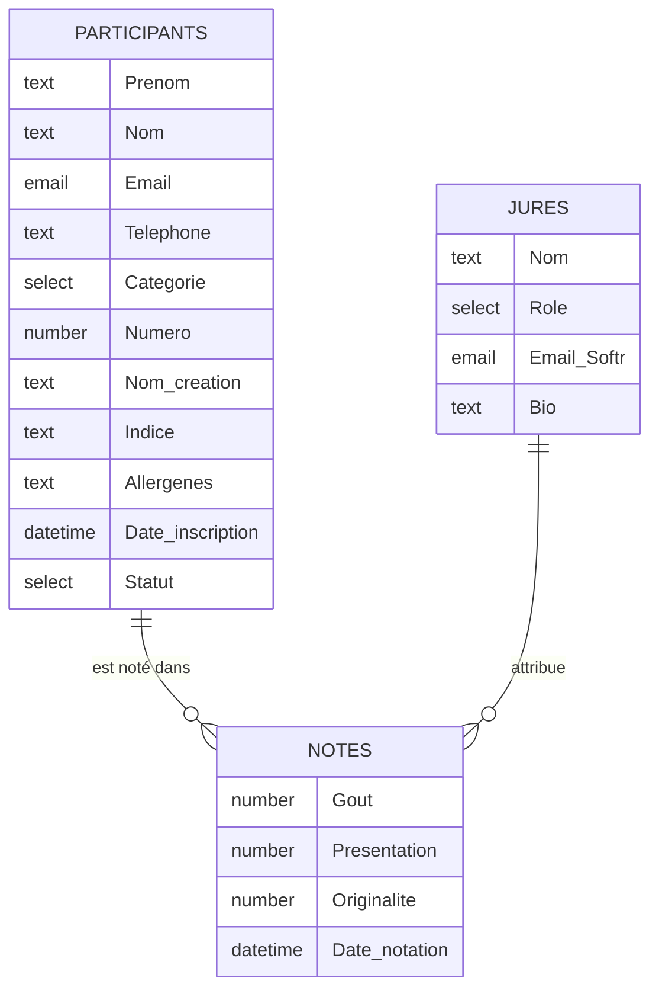

# Niveau 2 — Outil interne jury (Airtable + Softr)

> Spec complète pour monter le niveau 2 du cas Le Four du Canal. Permet aux 3 jurés de saisir leurs notes et à la cheffe de voir le classement temps réel pendant la délibération du 5 décembre.

---

## ERD (pour la skill `airtable-setup-from-erd`)

---

## Table 1 — PARTICIPANTS (max 20 lignes)

| Champ | Type | Options / usage |
| --- | --- | --- |
| Prenom | Single line text | Depuis Tally |
| Nom | Single line text | Depuis Tally |
| Email | Email | Depuis Tally |
| Telephone | Phone number | Depuis Tally |
| Categorie | Single select | Options : `Adultes 16 ans et plus`, `Juniors 10 à 15 ans avec un parent` |
| N° de création | Number (integer) | Attribué manuellement de 1 à 20 au dépôt de la pâtisserie le jour J (permet notation en aveugle) |
| Nom_creation | Single line text | Indice Tally, précisé à l'arrivée |
| Indice | Long text | Depuis Tally (Q8) |
| Allergenes | Long text | Depuis Tally (Q9) |
| Date_inscription | Created time | Auto |
| Statut | Single select | Options : `Inscrit`, `Déposé`, `Noté complet`. **Default value = `Inscrit`** pour que les lignes créées par Tally soient auto-initialisées |
| Notes | Link to NOTES | Multiple |
| **Rollup Note totale** | Rollup | Field `NOTES.Total`, aggregation `SUM()` |
| **Formule Rang Adultes** | Formula | `IF(Categorie="Adultes", RANK({Rollup Note totale}, FILTER_ALL_PARTICIPANTS_ADULTES))` — voir note ci-dessous |

### Note sur le classement

Airtable n'a pas de `RANK` natif efficace. Deux approches :

**Approche simple (recommandée)** : ne pas calculer le rang dans une formule. Créer deux vues :
- Vue **"Classement Adultes"** : filtre `Categorie = Adultes`, tri par `Rollup Note totale` décroissant
- Vue **"Classement Juniors"** : filtre `Categorie = Juniors`, tri par `Rollup Note totale` décroissant

C'est plus propre, plus simple, et ça s'affiche nickel dans Softr.

---

## Table 2 — JURES (3 lignes)

| Champ | Type | Options / usage |
| --- | --- | --- |
| Nom | Single line text | Ex: "Léa Martin" |
| Role | Single select | Options : `Chef pâtissière`, `Client fidèle`, `Personnalité locale` |
| Email_Softr | Email | Pour le login dans Softr |
| Bio | Long text | Court, affiché sur la landing / Softr |
| Notes | Link to NOTES | Multiple |

### Pré-remplir avec 3 jurés fictifs

| Nom | Role | Email_Softr |
| --- | --- | --- |
| Léa Martin | Chef pâtissière | lea@lefourducanal.fr |
| Pierre Etcheverry | Client fidèle | pierre@lefourducanal.fr |
| Juliette Larralde | Personnalité locale | juliette@lefourducanal.fr |

---

## Table 3 — NOTES (participant × juré, jusqu'à 60 lignes)

| Champ | Type | Options / usage |
| --- | --- | --- |
| Participant | Link to PARTICIPANTS | Single |
| Jure | Link to JURES | Single |
| Gout | Number (integer, 1-10) | Validation 1-10 |
| Presentation | Number (integer, 1-10) | Validation 1-10 |
| Originalite | Number (integer, 1-10) | Validation 1-10 |
| **Total** | Formula | `{Gout} + {Presentation} + {Originalite}` |
| Date_notation | Created time | Auto |

### Vues utiles

- **Mon pipeline** : groupé par `Jure`, trié par `Participant.Numero`
- **Toutes les notes** : chronologique

---

## Vues clés à créer dans Airtable

### Dans PARTICIPANTS

| Vue | Filtre | Tri |
| --- | --- | --- |
| Tous | — | Par N° de création |
| Classement Adultes | `Categorie = Adultes 16 ans et plus` | `Rollup Note totale` décroissant |
| Classement Juniors | `Categorie = Juniors 10 à 15 ans avec un parent` | `Rollup Note totale` décroissant |
| À noter | `Rollup Note totale < 90` (pas encore noté par les 3 jurés) | Par N° de création |

### Dans NOTES

| Vue | Filtre | Tri |
| --- | --- | --- |
| Pipeline jurés | — | Groupé par Jure, trié par Participant.Numero |

---

## Intégration Tally → Airtable

Dans Tally > ton formulaire concours > **Integrations** > **Airtable** :
- Base : `Notation - Le Four du Canal`
- Table : `PARTICIPANTS`
- Mapping champs :
  - Q1 Prénom → Prenom
  - Q2 Nom → Nom
  - Q3 Email → Email
  - Q4 Téléphone → Telephone
  - Q5 Catégorie → Categorie (valeurs doivent matcher exactement les options Single select)
  - Q8 Indice → Indice
  - Q9 Allergenes → Allergenes

⚠️ **Rappel règle apprise** : pas de virgule dans les libellés d'options Multiple choice Tally, sinon le parsing Airtable casse. Tes options sont OK (`Adultes 16 ans et plus`, `Juniors 10 à 15 ans avec un parent`).

Le champ Statut par défaut sera `Inscrit`. Tu le passeras manuellement à `Déposé` le jour J quand la création arrive.

---

## Interface Softr

### Pages à créer

#### 1. Page d'accueil `/`
- Logo Le Four du Canal
- Titre "Espace jury du concours"
- 2 boutons : "Se connecter" → `/login`, "Voir le classement" (accès restreint cheffe)

#### 2. Login `/login`
- Login par email (magic link ou mot de passe)
- Users = enregistrements de la table `JURES` (synchro avec Airtable via Softr)

#### 3. Dashboard juré `/mes-notations` (user logged in)
- H1 "Bonjour [Juré Nom]"
- Liste des Participants (vue "Tous") avec filtre dynamique "Non noté par moi"
- Pour chaque ligne : Numero, Nom création, Catégorie, bouton "Noter"
- Clic sur "Noter" → ouvre un formulaire pré-rempli avec Participant et Juré (current user)

#### 4. Formulaire de notation `/noter/:participant-id`
- Pré-rempli : Participant (nom + catégorie), Juré (user)
- 3 sliders ou 3 champs number (1-10) :
  - Goût
  - Présentation
  - Originalité
- Bouton "Enregistrer ma note"
- Confirmation : "Note enregistrée pour [Participant]"

#### 5. Classement temps réel `/classement` (accès cheffe uniquement)
- 2 sections côte à côte ou l'une sous l'autre :
  - **Classement Adultes** : liste des participants vue "Classement Adultes" avec Numero, Nom création, Total
  - **Classement Juniors** : idem avec vue "Classement Juniors"
- Auto-refresh toutes les 30s (option Softr)

### User groups Softr

| Groupe | Users | Pages accessibles |
| --- | --- | --- |
| Jurys | Léa, Pierre, Juliette | `/mes-notations`, `/noter/*` |
| Cheffe | Léa (double appartenance) | `/classement` en plus |

### Thème Softr

Même palette que la landing pour la cohérence :
- Primary : `#2346A8` (cobalt)
- Secondary : `#F2C94C` (beurre)
- Text : `#1C3380` (encre)
- Background : `#F6EEDF` (crème)
- Font : Inter (sans serif) + Fraunces (serif, pour les titres si possible)

---

## Deux voies pour le monter

### Voie A — Rapide, via ta skill Airtable (5 min pour la base)

Tu as déjà la skill `airtable-setup-from-erd` dans ton Jarvis. Elle construit la base entièrement depuis l'ERD Mermaid.

1. Dans claude.ai (pas Claude Code), ouvre une nouvelle conversation
2. Colle l'ERD Mermaid en haut de ce fichier
3. Dis : "Monte-moi cette base dans Airtable, workspace 'Projets freelance', nom de la base 'Notation - Le Four du Canal'. Rempli 3 lignes JURES factices et 5 participants factices pour tester."
4. La skill fait le reste en ~5 min

### Voie B — Manuel

Tu construis la base à la main dans Airtable en 45 min à partir de la spec ci-dessus. Plus long mais tu comprends tout ce qui se passe.

---

## Estimation effort global

| Étape | Temps |
| --- | --- |
| Base Airtable (voie A) | 15 min |
| Vérifier + ajuster vues | 15 min |
| Intégration Tally → Airtable | 15 min |
| Interface Softr (4 pages + user groups) | 2h |
| Tests (1 inscription, 3 notes, classement) | 30 min |
| Mise en ligne Softr + publication | 15 min |
| Mise à jour page Notion livraison | 10 min |
| **Total** | **~3h45** |

---

_Spec produite le 14 novembre 2026 pour le niveau 2 du cas Le Four du Canal._
